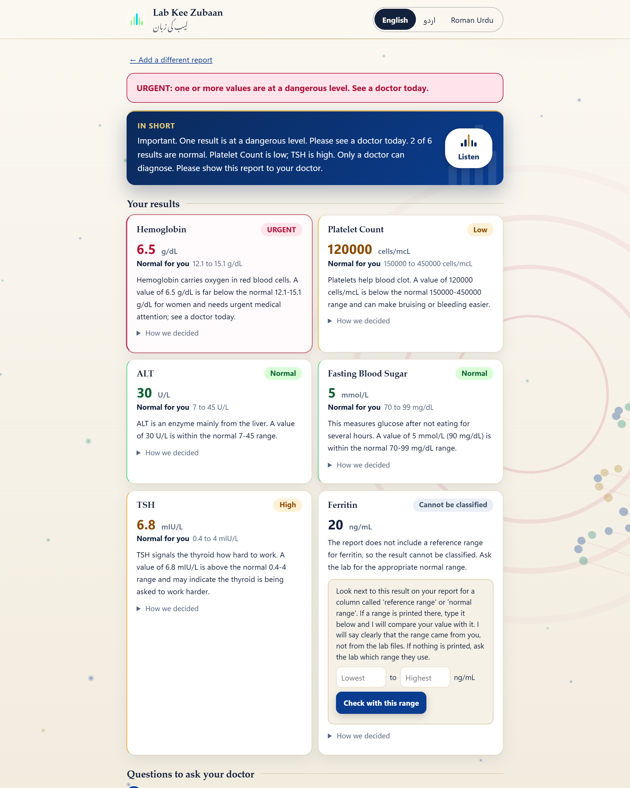

<div align="center">

# Lab Kee Zubaan

Lab reports explained in plain English or Urdu. Rules decide every result, the AI only writes the words.


</div>

## Overview

Most people cannot read their lab report, and a chatbot that guesses about health is dangerous. Lab Kee Zubaan ("the language of the lab") reads a report, marks every result normal, low, high or urgent using the lab's own reference files, explains each test in simple words, suggests questions for the doctor, and can read the summary aloud in English, Urdu or Roman Urdu. A rules engine decides every fact. The AI only writes the words, and a checker throws away any sentence with an invented number or a diagnosis.

Built in one day for the Tech Fusion '26 AI Hackathon (AI Club, Bahria University Islamabad), Challenge B, by Shahram Shafiq and Sara Nasir.

## Demo



Two sample reports are in [demo/](demo): a PDF and a photo of a printed report.

## Key Features

- **Many file types:** PDF (text and scanned), Word, Excel, CSV, HTML, RTF, text, and photos or screenshots of reports. Photos are read on the server with OCR, nothing is sent to an outside service.
- **Safe by design:** the lab's rules classify every value (a value exactly on a limit is normal, urgent limits give a "see a doctor today" warning, the first doctor question is about the urgent result). It never diagnoses and refuses questions about other patients.
- **Never guesses:** missing age or sex means it asks. A test with no range is "cannot be classified", and the page tells the patient to look for the range printed on their report, which they can type in and which is then marked as coming from them.
- **Awkward reports handled:** units converted with the formula shown, names in other orders or with brackets, flags like "(L)" or "CRITICAL" ignored, "<10" and ">1000" on danger tests, "1,200", pending and blank results, duplicates and conflicts, ages in months.
- **Voice and chat:** speech to text, spoken answers, and a chat locked to one report. Finished answers are remembered so a repeated question is instant.
- **Three languages:** English, Urdu and Roman Urdu for the whole page, the answers and the voice.
- **Privacy:** the patient name and record number are removed before anything is sent to the AI and never leave the server in a response.

## Tech Stack

| Area | Technology |
|---|---|
| Backend | Python 3.12, FastAPI, Uvicorn |
| AI | Groq (gpt-oss models) with Gemini as fallback, called only from `app/llm.py` |
| Speech | Groq Whisper (speech to text), edge-tts neural voices (text to speech) |
| File reading | pypdf, openpyxl, rapidocr-onnxruntime |
| Front end | Plain HTML, CSS and JavaScript, three.js background built with esbuild |
| Packaging | Docker and Docker Compose |
| Tests | pytest |

## Project Structure

```text
app/             Backend modules
  knowledge.py   Reads the lab's reference files and remembers the file and line
  extract.py     Reads a report into a patient and a list of results
  readfile.py    Turns any uploaded file into text (PDF, Word, Excel, photo and more)
  units.py       Unit conversions shown as formulas
  engine.py      Statuses, urgent limits, doctor questions
  explain.py     AI-written words plus the checker and a cache
  chat.py        Chat locked to one report, with a cache for finished answers
  guard.py       Guardrails for diagnosis, medicine, other patients and attacks
  llm.py         The only place that calls an AI service (retries, fallback, deadline)
  voice.py       Speech to text and text to speech
  plain_ur.py    Urdu texts written ahead of time
  main.py        API routes
static/          The web page, i18n.js holds the Urdu and Roman Urdu words
tools/           Source of the 3D background and its build script
lab_reports/     The lab's reference files and 14 sample reports
demo/            Two sample reports for trying the app
scripts/         smoke_test.py, latency_check.py, prewarm_demo.py
tests/           Automated tests
```

## Getting Started

### Prerequisites

- Docker, or Python 3.12
- Optional API keys for Groq and Gemini. Without keys the app still works with the rules-written text.

### Installation

```bash
git clone https://github.com/shahramshafiq/lab-kee-zubaan.git
cd lab-kee-zubaan
cp .env.example .env
```

Put your own keys in `.env`. The main settings are `PROVIDER_ORDER`, `GROQ_API_KEY`, `GEMINI_API_KEY`, `GROQ_MODELS`, `GEMINI_MODELS`, `STRICT_DEMOGRAPHICS`, `TTS_VOICE_EN`, `TTS_VOICE_UR` and `DATA_DIR`. Every variable is listed in `.env.example`.

### Run

With Docker:

```bash
docker compose up --build
```

Without Docker:

```bash
python -m venv .venv
.venv\Scripts\activate        # on Mac or Linux: source .venv/bin/activate
pip install -r requirements-dev.txt
uvicorn app.main:app --port 8000
```

Open http://localhost:8000

## Usage

- Drop a report on the page, or choose "Try an example", then press "Explain my report".
- Press Listen for the spoken summary, or use the microphone to ask a question.
- Check a running app with `python scripts/smoke_test.py --ai --voice`, and measure speed with `python scripts/latency_check.py`.

| Route | What it does |
|---|---|
| `POST /api/analyze` | Text or a sample report id gives results, explanation and doctor questions |
| `POST /api/analyze-file` | The same for an uploaded file of any supported type |
| `POST /api/explain` | The AI-written words for a report already analysed |
| `POST /api/user-range` | The normal range typed by the patient for a test with no range |
| `POST /api/chat`, `POST /api/chat-stream` | Questions locked to one report (the stream sends sentence by sentence) |
| `POST /api/stt`, `POST /api/tts`, `GET /api/tts-stream` | Speech to text and text to speech |
| `GET /api/health`, `/api/metrics`, `/api/usage`, `/api/demo-reports`, `/api/warmup` | Status, counters, AI budget, samples, warm-up |

## Testing

```bash
pytest
```

The tests never call a real AI service. They cover all 14 lab reports, every file type, range and age edges, unit conversions, awkward lines, attacks hidden in a report or in chat, streaming, and the AI being down or returning nonsense.

## Limitations and Roadmap

- The lab's files have ranges for only ten tests and only for ages 18 to 100. Anything else is "cannot be classified" on purpose.
- Unit conversion factors are standard textbook values, because the lab files do not list them.
- Photo reading depends on photo quality. Scanned reports should be sharp and straight.
- The Urdu texts were not reviewed by a native speaker. The voice uses Microsoft's free neural voices through the unofficial `edge-tts` package, and the Urdu voice is slower than English.
- Sessions live in memory, so one instance only, and there is no public deployment yet.
- Next steps: WhatsApp delivery with a staff review for urgent results, and ranges for children.

## Author

**Shahram Shafiq** - [GitHub](https://github.com/shahramshafiq) | [LinkedIn](https://www.linkedin.com/in/shahramshafiq/)

Built together with **Sara Nasir** - [GitHub](https://github.com/nasarara2541)
